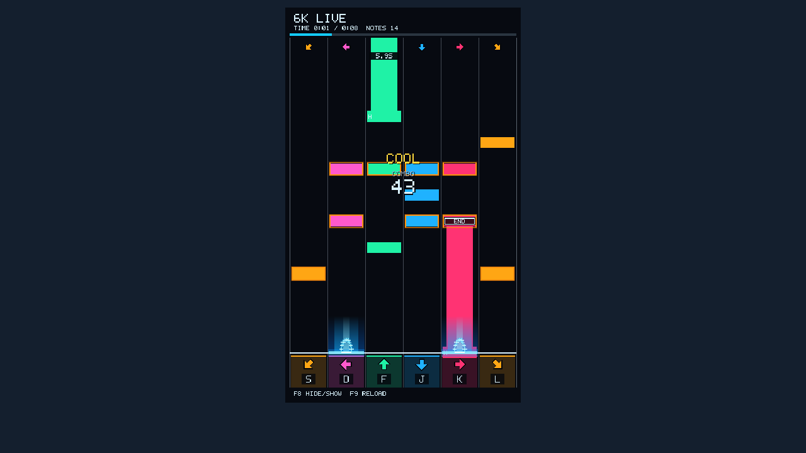

# DivaMania6K

为《初音未来 Project DIVA MEGA39's＋ / Hatsune Miku: Project DIVA Mega Mix+》提供六轨下落视图的 Windows x64 原生插件，基于 DivaModLoader 的 D3D11 回调。

当前版本 **0.2.17** 已完成本机游玩验证。读取真实谱面、游戏时钟和判定，支持纯色音符、同时押橙框、HOLD 长条、连续滑条、连击、判定提示、歌曲进度与点击光效。

**这是视图插件，不改游戏输入或判定。** 原游戏键位需要自行设置，显示键帽不等于自动绑定；同向双滑条仍需满足原游戏输入要求。



预览使用构造谱面与状态，展示 HOLD 尾帽及剩余时间，不包含游戏资源或实机画面。

## 安装

1. 在游戏根目录安装并启用 [DivaModLoader](https://github.com/blueskythlikesclouds/DivaModLoader)。
2. 从本仓库 [Releases](https://github.com/fygdjbbgnk5326-crypto/DivaMania6K/releases) 下载安装包，将其中 `DivaMania6K` 文件夹放进游戏的 `mods` 目录。
3. 确认 `config.toml` 中 `enabled = true`。升级时替换 DLL 和 config.toml，保留自己的 Player.ini。
4. 完整退出并重启游戏。进入歌曲后显示六轨，结果画面停止计时；返回菜单后默认隐藏。

F8 显示/隐藏，F9 重新读取 Player.ini；更新 DLL 必须重启游戏。

六轨从左到右：**S 左滑、D 左/□、F 上/△、J 下/×、K 右/○、L 右滑**。方向键及左右 Ctrl 可触发对应显示光效。

## 显示设置

编辑安装目录的 Player.ini / `[View]`，按 F9 应用。完整默认值见 [Player.ini](Player.ini)。

- `FallTimeMs=1200`：音符下落窗口，200–5000 毫秒。
- `OffsetMs=0`：显示偏移，-1000–1000 毫秒；正数使音符更晚到判定线。
- `LaneWidth=90`：1080p 参考单轨宽度，48–140。
- `PositionY=-60`：整体纵向偏移，-70–150，负数上移。
- `BackgroundOpacity=95`：深色背景不透明度，即 5% 透明。
- `ColoredOpacity=100`：长条等彩色填充不透明度。
- `ArrowBackgroundOpacity=20`：底部方向图标区域的背景不透明度。
- `LaneLineOpacity=30`、`LaneLineWidth=1`：分隔线亮度及宽度。
- `ClickEffects=1`、`ClickBeamHeight=90`、`ClickFadeMs=360`：点击光效开关、高度和淡出时长。
- `MultiPressOutline=1`：同时押橙框。
- `JudgementDurationMs=500`、`FeedbackPositionPercent=45`：判定提示时长及反馈纵向位置。
- `SmoothAnimation=1`：游戏时钟采样间的有限动画补间；不解锁游戏帧率。
- `HideInMenus=1`：无活动歌曲时隐藏。

## HOLD 与兼容性

原作 HOLD 没有固定释放尾点。本插件按当前六键连续正确游玩的 MAX、追加 HOLD、同键重击和歌曲结束规则预计算推荐持续区间。入场即展示长条，命中后尾部不突然拉长；屏幕外尾部显示剩余秒数，进入屏幕后显示 END 尾帽。

主动松键、漏掉追加 HOLD、双绑/宏换手或判定时差可能使实际奖励终点与推荐路线不同。插件只读真实持续状态，不改变 HOLD 奖励或释放规则。

当前内存结构仅在 Steam **build 11004484** 的本机版本确认；其他版本及第三方改谱未全面验证。Getter 指令不匹配时停用读谱。普通及 SINGLETHREADED D3D11 设备均有自动测试。

## 构建与测试

安装 Visual Studio C++ x64 工具链和 Windows SDK，双击或在命令行执行：

```bat
build.cmd
test.cmd
```

脚本通过 vswhere 自动查找工具链。发行输出为 `build/DivaMania6K.dll`，安装时将其命名为 config.toml 指定的版本 DLL。

测试包含谱面映射、真实内存结构夹具、判定后消失、HOLD 预计算、结束计时、动画补间、WARP 绘制、状态恢复和窗口缩放。真实谱面采样测试仅在本机存在 `build/real-chart.bin` 时运行；仓库不分发采样文件。调试工具可选，需要本机游戏或 IDA/MCP，不是普通安装依赖。

详细适配记录见 [开发记录](docs/DEVELOPMENT.md)。

## 许可与参考

项目采用 [MIT License](LICENSE)。New Classics 的参考代码/结构声明保留其 [MIT 许可](LICENSE.NewClassics)。

- [DivaModLoader](https://github.com/blueskythlikesclouds/DivaModLoader)
- [New Classics](https://github.com/mrcloverthecoder/nc)
- [ManiaInMuse](https://github.com/SanwuQian/ManiaInMuse)：视图思路参考，本插件不依赖 MelonLoader/Unity。

仓库不包含游戏程序、游戏资源、完整谱面、内存转储或 IDA 数据库。
